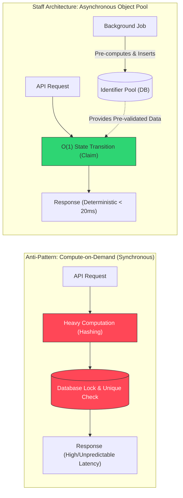

# 🧱 Engineering Brick: The Law of Decoupled Computation

> 🌸 *Do not forge your blade in the heat of the fight,*
> *Nor dam the raging river's sudden might.*
> *Store the essence where the silent waters lie,*
> *When the call is made, a thousand forms fly.*

## 🌠 1. The Formal Specification (Problem Model)

In large-scale distributed systems—such as Core Ingestion Pipelines, Entity Resolution Engines, or Global Tracking Systems—we frequently encounter the challenge of **High-Speed Resource Allocation**. 

**The Workload & Constraints**:
* **The Task:** The system must generate or assign a `Global Tracking Identifier (GTI)` for every incoming payload. This identifier often requires complex hashing, cryptographic checksums, or strict format validations.
* **Throughput:** 10,000+ Requests Per Second (RPS).
* **Latency SLA:** < 20ms at p99.
* **The Anti-Pattern:** The system performs the computation or generation of the GTI synchronously during the critical path of the API request.

---

## 🪞 2. What Breaks First at Scale (The Failure Mode)

A common optimization instinct is to make the generation algorithm faster. The deeper architectural move is to recognize that **computation inside the critical request path is an architectural liability.**

As traffic increases, the "Compute-on-Demand" model fractures:
1. **CPU Throttling:** Heavy computation during traffic spikes consumes CPU cycles, leading to starvation and cascading timeouts across the service mesh.
2. **Coupling Compute with Network I/O:** Checking global uniqueness in a database during request time ties your API's latency to DB index traversal speeds under heavy lock contention.
3. **Tail Latency Amplification:** Non-trivial work in the request path disproportionately increases **p99 latency**. While average latency might look acceptable, the "tail" will punish your users as the system scales.
4. **Loss of Determinism:** Unpredictable computation time under varying loads is indistinguishable from downtime in a high-throughput environment.

---

## ⚡ 3. The Design Dialogue (Socratic Review)

*This design review uses a challenger voice to break down the "optimization" myth.*

> **🕵️ The Challenger**: Our allocation API is timing out under heavy load because the cryptographic hashing is too slow. Let's rewrite the `IdentifierGenerator` service in Rust or C++ and vertically scale the pods. 

**🧑‍💻 The Architect**:
Rewriting in Rust will lower your *average* latency, but it will not fix your architecture. If 10,000 concurrent requests hit the API simultaneously, they still compete for the same CPU cores and the same database locks to verify uniqueness. The p99 tail latency will still spike. It is a structural bottleneck, not a language problem.

> **🕵️ The Challenger**: Then let's shield the database. We can cache the generated IDs in a Redis cluster and check for uniqueness there using distributed locks before saving to PostgreSQL.

**🧑‍💻 The Architect**:
You are just moving the contention from PostgreSQL to Redis. You have now added a network hop, distributed lock management, and split-brain risks to the critical path of a simple allocation request. 
The problem is not *how fast* we compute or *where* we check it. The problem is **when** we are doing the work. You are forcing the user to wait while the server thinks.
You are not solving a performance issue. You are misplacing time in the system.

---

## 🌌 4. The Law of Decoupled Computation

In any high-throughput system, **any non-trivial computation inside the critical request path is a debt that will eventually be called.** To scale predictably, we must obey a fundamental law:

> **Eliminate computation from the latency-critical path by moving the work across time or space.**

Latency is not just a performance metric. It is a budget that must be explicitly allocated across time. This principle is the root of several advanced architectural patterns:
* **Pre-allocation:** Moving work from the future (request time) to the past (background processing).
* **Write-behind caching:** Moving work from the present to the future.
* **Materialized Views:** Moving work from read-time to write-time.

It is not just about identifiers; it is about **where time is allowed to exist in your system.**

### 🧭 4.1 The Decision Framework: When to Move the Work

The Law of Decoupled Computation is not free; it introduces storage costs and consistency trade-offs. Before applying it, use this framework:

1. **Is this computation on the critical path?** If it directly affects request latency, it is a primary candidate for decoupling.
2. **Is the computation repeatable or predictable?** If the output can be pre-computed or pooled, do not wait for the request.
3. **Can the system tolerate temporal drift?** If yes, pre-allocation or asynchronous pipelines are viable.
4. **What is the cost of being wrong vs. being slow?**
    * *Financial/Ledger systems:* Correctness first.
    * *Tracking/Ingestion systems:* Throughput first.

**Systems do not fail because they compute too slowly. They fail because they compute at the wrong time.**

---

## 🧩 5. One Manifestation: The Asynchronous Object Pool

To achieve a deterministic sub-20ms SLA, we transition to an **Asynchronous Object Pool Architecture**.

### 🏛️ 5.1 The Invariant (The Pillar)
*The critical path of the allocation API must contain zero heavy computation. It must be reduced to an O(1) state transition.*

### 🗺️ 5.2 The Architectural Shift (Data Flow)



### 🛠️ 5.3 The Core Skeleton (The Implementation)

```java
// 1. The Background Generator (The Computator)
@Component
@RequiredArgsConstructor
public class IdentifierPreAllocationJob {
    private final AllocationRepository repository;
    private final ComplexIdentifierGenerator generator;
    
    @Scheduled(fixedDelay = 5000)
    public void replenishPool() {
        // Heavy computation happens here, safely isolated from users!
        List<ResourceDescriptor> newBatch = generateBatch(BATCH_SIZE);
        repository.saveAll(newBatch);
    }
}
// O(b) time | O(b) space (where b is BATCH_SIZE)

// 2. The High-Speed Consumer (The Critical Path)
@Service
@RequiredArgsConstructor
public class FastAllocationService {
    private final AllocationRepository repository;

    @Transactional
    public String allocateIdentifier(String consumerId) {
        // This is no longer a computation problem. 
        // It is now a pure state transition problem.
        ResourceDescriptor asset = repository.claimNextAvailable();
        if (asset == null) throw new ResourceExhaustionException();

        asset.markAsPending(consumerId);
        return asset.getIdentifierValue();
    }
}
// O(1) time | O(1) space
```

### 💠 5.4 The Pivot Insight
**Do not optimize the computation — eliminate it from the critical path, or pay for it at scale.** We pay the computational cost when the system is idle to reap absolute determinism when it is under peak load.

---

## ☯️ 6. Production Realism & Trade-offs

### ☯️ 6.1 Consistency vs. Availability
Pre-allocation introduces a temporal gap between generation and usage, shifting the system toward **eventual consistency**. We accept a minor drift—where an ID might be generated but abandoned—in exchange for absolute availability and linear throughput. 

This is a conscious shift from strict correctness at request-time to correctness over time.

### ☯️ 6.2 The Storage Tax
We trade **Storage Space** for **CPU Time**. For lightweight identifiers, this is an efficient bargain. For heavy assets (e.g., pre-rendered documents), this can lead to storage bloat and requires aggressive garbage collection.

---

## 🗝️ 7. The "Brick" Summary (Mental Model)

When architecting systems for extreme scale, memorize this blueprint to instantly recognize and neutralize computation bottlenecks.

* **🌠 Signal:** Unpredictable tail latency (p99 spikes) or CPU throttling caused by complex data generation, hashing, or validation during the request cycle.
* **🧩 Structure:** The Asynchronous Object Pool (Decoupled background generation + $O(1)$ foreground consumption).
* **🏛️ Invariant:** The critical path of the API must contain zero heavy computation; it is strictly reduced to a state transition.
* **💠 Pivot Insight:** Systems do not fail because they compute too slowly. They fail because they compute at the wrong time. Eliminate computation from the critical path by moving the work across time. Trade storage space for CPU time.

---
🪷 *One sentence to trigger the reflex:* **"Move the work out of the latency path; pay the cost when idle, reap the speed under load."**
