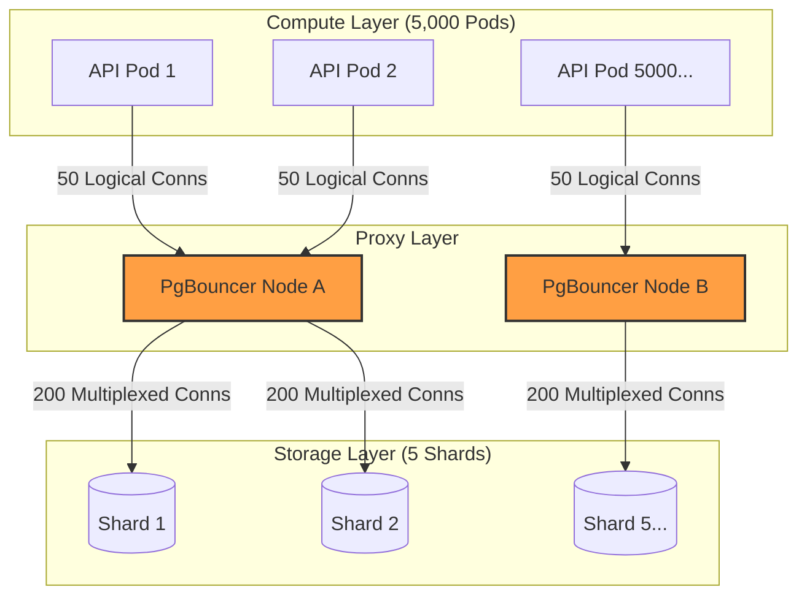

# 🧱 Engineering Brick: The Law of Fragmented State

> 🌸 *The vessel cracks beneath the rising sea,*
> *So split the stream and let the waters flee.*
> *But guard the gates where thousand threads align,*
> *Or drown the shards before they ever shine.*

## 🌠 1. The Formal Specification (Problem Model)

In [Part 3](), we perfected our allocation queue using `SKIP LOCKED`, Stateful Leases, and Fencing Tokens. The system is structurally robust and preserves correctness under the failure modes we have addressed so far.

However, software runs on hardware. 

**The Workload & Constraints**:
* **The Task:** Dispatch IDs to thousands of concurrent API Pods.
* **The Limit:** A single monolithic PostgreSQL instance hits a physical ceiling. The Write-Ahead Log (WAL) maxes out the SSD's IOPS, and index page-latch contention destroys CPU efficiency at around **40,000 RPS**.
* **The Requirement:** We must scale horizontally to **200,000+ RPS** by partitioning the database (Sharding).

---

## 🪞 2. The Naive Shard & The Failure Mode

The standard architectural response to hitting a database ceiling is Hash Partitioning. We spin up 5 PostgreSQL instances (Shards). 

### 📊 2.1 The Mathematics of a Connection Collapse
Sharding divides data, but **it multiplies the topology**. PostgreSQL uses a strict process-per-connection model. 

Assume you have a large Kubernetes cluster:
* **API Pods:** 5,000 pods.
* **Shards:** 5 database nodes.
* **Topology Demand:** Without multiplexing, a pod that needs effective access to 5 shards often forces the topology toward 50 live upstream client connections in aggregate (e.g., a pool of 10 per shard).

If every pod connects directly to every shard, the math is brutal:
5,000 pods * 10 logical connections = **50,000 connections per shard.**

This scale can imply **hundreds of gigabytes of memory overhead** in the worst case, just to keep idle connections open. PostgreSQL will immediately trigger the OOM Killer or reject connections with `FATAL: sorry, too many clients already`.

---

## ⚡ 3. The Design Dialogue (Socratic Review)

> **🕵️ The Challenger**: If connections are the problem, we should just lower the connection pool size in our Java apps to 1 per shard.

**🧑‍💻 The Architect**:
If you drop the connection pool to 1, you destroy the concurrent throughput of the Pod. Threads inside the Pod will block each other waiting for that single database connection. 
**You cannot solve a fan-out connection problem by starving your compute layer.** We need a multiplexer.

---

## 🧩 4. The Architectural Shift: Connection Multiplexing

Scaling a sharded relational database requires a **Connection Multiplexer** (e.g., PgBouncer, Envoy, or a Data Access Layer) to sit between application pods and database shards.

### 🗺️ 4.1 The Multiplexed Topology

> **Architectural Doctrine:** Horizontal scale is not achieved when data is split. It is achieved when coordination cost grows slower than load.

---

## 🌐 5. Intelligent Routing & Shard Skew

**The Hot Shard Trap:** Random routing is statistically cheap but operationally naive. Once one shard becomes hotter (or depletes faster), retries and fallback behavior can amplify the skew unless routing decisions are informed by recent local health signals.

**The Solution: The Power of Two Choices.**
Instead of picking 1 random shard or querying all of them, the worker selects exactly **two** random shards and routes the request to the one that appears healthier. 

In practice, the decision is driven by **cached health signals, lightweight shard occupancy counters, or periodically refreshed local metrics.** This algorithm mathematically guarantees near-optimal load balancing without the overhead of global consensus.

---

## ⛩️ 6. System Integrity Boundaries

### ⛩️ 6.1 The Fencing Truth After Sharding
**Sharding does not preserve a global order of tokens across the fleet; it preserves monotonic truth for each resource at its authoritative shard.**
> *Note on Scope:* This article solves topological scale and connection pressure, not global transactional correctness across shards. Once workflows span multiple shards, new coordination laws apply.

### ⛩️ 6.2 The Limits of Multiplexing
PgBouncer is not magic. Introducing transaction-level multiplexing comes with strict boundaries:
* Long-running transactions severely weaken pooling efficiency.
* Transaction pooling breaks session-dependent features.
* Prepared statements, temporary tables, and session state can heavily constrain proxy modes.

### 🏛️ 6.3 The Topological Invariant
**At scale, shard fan-out must be terminated before it reaches the storage layer; otherwise, connection growth outpaces useful throughput.** Direct shard fan-out becomes unsustainable, and a multiplexing layer becomes the default architecture.

---

## 👁️ 7. The Control Plane (Observability)
To safely operate this architecture, monitor these critical metrics:
* **Proxy Saturation:** Ratio of active client connections to multiplexed backend connections.
* **Shard Skew:** Occupancy and depletion rates across individual shards.
* **Micro-Latency:** P99 allocation latency *isolated by shard*.
* **Queue Depth:** PgBouncer wait times (Leading indicator of backend lock contention).

---

## 🗝️ 8. The "Brick" Summary (Mental Model)

* **🌠 Signal:** Database hitting max connections, OOM Killer active, or high lock-wait times.
* **🧩 Structure:** Hash Partitioned Shards + Connection Multiplexer + Power of Two Choices routing.
* **🏛️ Invariant:** Monotonicity is per-resource. Shard fan-out must be proxy-terminated.
* **💠 Pivot Insight:** Horizontal scale is achieved not by splitting data alone, but by ensuring coordination cost grows slower than load.

---
🪷 *One sentence to trigger the reflex:* **"Sharding does not divide your problems; it distributes them. Proxy the connections before you split the data."**
