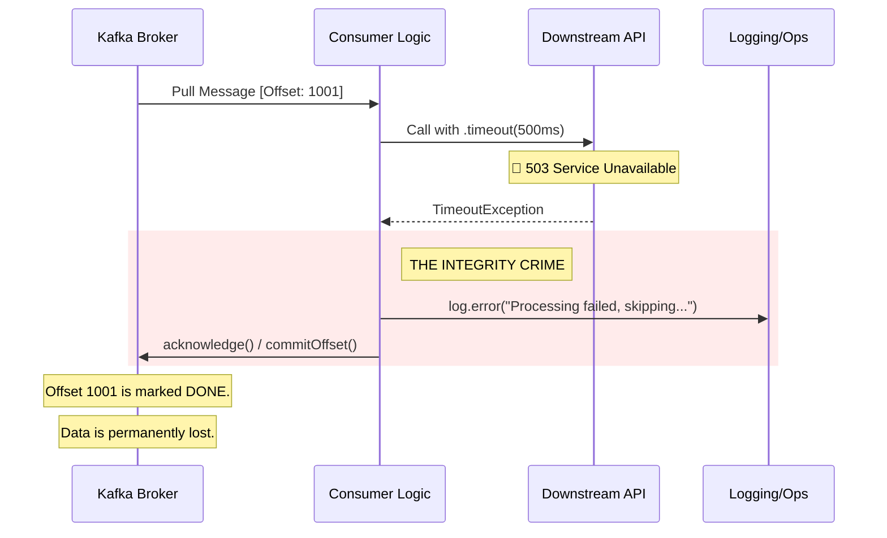

# 🧱 Engineering Brick: The Law of Non-Lossy Recovery

> 🌸 *The river flows without a stain,*
> *But hidden deep is all the grain.*
> *To clear the path by casting wide,*
> *Is but a debt that none can hide.*

## 👁️ 1. The Context & The Symptom

In our journey through this autopsy series, we have restored visibility and unlocked frozen threads. The system appears stable. The Kafka lag has vanished. The dashboards are green once more.

However, a new and more terrifying symptom emerges: **Audit Inconsistency**. The upstream state machine (Checkout Gateway) claims it routed 1,000 Payment Capture events, but the downstream Settlement system only recorded 950. There are no errors in the logs. No alerts in the terminal. The 50 missing financial transactions have simply evaporated.

This is the **Integrity Fallacy**: the dangerous belief that a cleared queue is a successful process. This post dissects the "Catch-and-Commit" anti-pattern—the silent killer of data integrity.

---

## 🌠 2. The Formal Specification (Problem Model)

In a distributed event-driven system, we must distinguish between the **Transport Contract** and the **Processing Contract**.

**The Integrity Model:**
* **The Promise:** At-least-once delivery.
* **The Failure Mode:** Transient downstream unavailability (e.g., Fraud API 503).
* **The State Boundary:** Once an offset is committed to the broker, the message is semantically "done."
* **The Global Invariant:** A clean queue is not evidence of success; it is only evidence that the pointer moved. The ingestion offset must never advance unless the payload has reached a terminal state of success OR has been durably persisted in a secondary fault-domain (DLQ).

---

## 🪞 3. The Anatomy of Silent Data Loss (Failure Mode)

The most common cause of silent data loss is a "well-intentioned" but architecturally fatal `try-catch` block.

### 🛑 3.1 The "Catch-and-Commit" Trap

When the downstream API fails (e.g., 500ms timeout), the code enters the `catch` block. To prevent the "Zombie Consumer" state discussed in [Part 1](), a developer adds a timeout. But then, they make the fatal choice of acknowledging the message to "keep the pipeline moving."

### 🛑 3.2 The Toil Trap (Human Janitors)
By acknowledging a failed transient error, the responsibility is inverted from the software to the people. A **Human Janitor** (Support/SRE) must now manually identify, extract, and re-inject those lost transactions. At scale, this "Toil" is more expensive than any infrastructure cost.

---

## 📊 4. The Quantitative Mandate: The Cost of Amnesia

At production scale, we measure the **Recovery Toil (RT)** against the **Infrastructure Cost (IC)** of a Dead Letter Queue (DLQ).

* **Message Volume:** 10,000,000 messages/day.
* **Failure Rate:** 0.1% (10,000 failures).
* **Manual Recovery Time:** 5 minutes/message (Investigation + Re-injection).
* **Total Toil:** 50,000 minutes ≈ **833 Engineering Hours.**

**The Decision:**
One "clever" catch block costs the company **5.2 engineering months** of manual work for a single day of network instability. Architecture is the art of minimizing future toil.

---

## ⚡ 5. The Design Dialogue (Socratic Review)

> **🕵️ The Challenger**: Why not just use "Infinite Retries"? If we don't acknowledge the message, Kafka will redeliver it forever until the downstream API recovers.

**🧑‍💻 The Architect**:
Infinite retries lead to **Head-of-Line (HOL) Blocking**. In ordered partitions, one poisoned offset can hold the entire lane hostage. No other messages can pass. Lag explodes, and the system is back to Part 1. Moving the failure out of the main flow is the only way to break the deadlock.

> **🕵️ The Challenger**: Is a DLQ always necessary? It adds complexity and more topics to manage.

**🧑‍💻 The Architect**:
A retry topic is for **uncertainty** (transient 5xx). A dead-letter topic is for **irreducible failure** (4xx/Poison Pills). For state-changing financial commands, a DLQ is not a luxury—it is a mandatory "Safety Valve." It preserves the **Liveness** of the main pipeline while guaranteeing the **Correctness** of failed events.

---

## ⛩️ 6. System Integrity Boundaries

### ⛩️ 6.1 The DLQ Mandate (The "Safety Valve")
Every consumer handling critical business state must have an automated fallback topic system.
* **Retry Topic:** For transient errors with exponential backoff.
* **Dead Letter Topic:** For fatal errors requiring manual inspection.

### 🏛️ 6.2 The Atomic Commit Rule
The ingestion offset must not advance before the fallback write is durable.
1. **Try Process.**
2. **If Fail:** Write to Fallback Topic (Retry/DLQ) + Flush/Sync.
3. **Commit Ingestion Offset.**

*Note: In practice, the exact mechanics depend on the broker stack (e.g., Transactional Producers), but the invariant remains: durable persistence of the failure state must precede the advancement of the source pointer.*

---

## 🗝️ 7. The "Brick" Summary (Mental Model)

* **🌠 Signal:** Zero lag, but business data is inconsistent. Support teams are doing manual data re-injection.
* **🧩 Structure:** Main Topic + Retry Topic (Uncertainty) + DLQ Topic (Irreducible Failure).
* **🏛️ Invariant:** A clean queue is not evidence of success; it is only evidence that the pointer moved.
* **💠 Pivot Insight:** Committing a poison pill *after durable isolation* saves the pipeline; committing a timeout *without fallback* betrays the data.

---
🪷 *One sentence to trigger the reflex:* **"A queue with zero lag can still be a crime scene; don't trade your data for a clean dashboard."**
