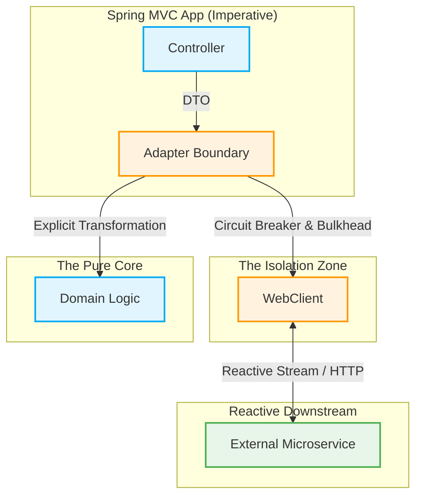

## 🧱 Engineering Brick: The Backpressure Betrayal & The Blueprint for Safe Boundaries

🌸 *A river flows as fast as it can,*  
*Until a dam breaks, built by a careless man.*

### 🪞 1. The Final Autopsy: The Silent OOM

Over the past three autopsies, we have dissected the subtle, structural failures that arise when imperative and reactive paradigms are blindly mixed. We exposed the [Concurrency Illusion]() where threads saturated while CPUs slept. We explored the [Temporal Rift]() that silently invalidated security signatures. We mapped the [Context Propagation Collapse]() that stripped identities in mid-flight.

Those failures caused latency degradation, 401s, and authorization bugs. But our final autopsy examines a failure that takes down the entire node: **The Backpressure Betrayal**.

The symptom surfaces during a seemingly benign operation. A legacy Spring MVC (Tomcat) endpoint uses `WebClient` to fetch a large dataset from a downstream service to generate a report. In staging, it works perfectly. In production, during peak hours, the JVM suddenly flatlines. An `OutOfMemoryError` (OOM) kills the container. No warning. No CPU spike. Just death.

```java
@GetMapping("/api/v1/reports/transactions")
public ResponseEntity<List<TransactionDTO>> getReport() {
    // ❌ THE HIDDEN TRAP: The Backpressure Betrayal
    List<TransactionDTO> transactions = webClient.get()
        .uri("/internal/transactions?status=COMPLETED")
        .retrieve()
        .bodyToFlux(TransactionDTO.class)
        .collectList() // Pulls the infinite stream into a single heap allocation
        .block();      // Blocks the Tomcat thread until the stream completes
        
    return ResponseEntity.ok(transactions);
}
```

### ☯️ 2. The Ideological War: Push vs. Pull

To understand why this crashes, we must look at the physics of the two paradigms.

**The Imperative Philosophy (Synchronous):** "Give me everything. I will halt my thread and wait here until you have gathered all the data." It has no native concept of signaling, "I can only process 10 items at a time."

**The Reactive Philosophy (Asynchronous & Backpressured):** "I will stream data to you continuously. To protect yourself, you must tell me your capacity using `request(n)`. I will not push more than you can handle."

When these two worlds collide via `.collectList().block()`, the reactive stream detects that the subscriber wants the *entire* list. The subscriber (the imperative thread) effectively issues a `request(Long.MAX_VALUE)`. 

The downstream service complies, aggressively streaming hundreds of thousands of records. The reactive framework dutifully buffers them in memory, waiting for the stream to complete so it can hand the final `List` to the blocked imperative thread. The imperative code has betrayed the core safety mechanism of the reactive stream: **Backpressure**.

### 📊 3. Quantitative Mandate: The Physics of Memory Bounds

In a pure reactive system, memory is bounded because the consumer processes items iteratively and signals capacity:

$$ Memory \approx \max(0, Rate_{Production} - Rate_{Consumption}) \times Time $$

With Backpressure, if $Rate_{Consumption} < Rate_{Production}$, the system signals the producer to slow down. Memory consumption remains constant, bounded by the `prefetch` window.

In a hybrid system using `.collectList().block()`, backpressure is disabled. The framework is forced to buffer continuously:

$$ Memory = Total\_Dataset\_Size $$

If $Total\_Dataset\_Size > Available\_Heap$, the risk of OOM scales linearly until inevitable collapse. The physics are unforgiving. But before reaching for a patch, a more fundamental architectural question needs to be asked.

### 💠 4. The Architectural Core Question: Should This Be Hybrid?

*"Does this endpoint belong in a pure reactive service instead?"*

If the endpoint's sole purpose is to stream massive amounts of data from a reactive downstream to a client, wrapping it in an imperative Tomcat controller is often an architectural regression. A cleaner approach is to migrate the endpoint to a Spring WebFlux service, preserving the end-to-end backpressure pipeline. 

However, if the endpoint requires deep integration with legacy imperative libraries (e.g., legacy JPA repositories, synchronous PDF generators), migration might be infeasible. In those scenarios, designing a safe hybrid bridge becomes necessary.

### 🧭 5. The Decision Framework: When to Bridge and When to Migrate

| Scenario | Architectural Choice | Mechanism & Safeguard |
| :--- | :--- | :--- |
| **High throughput I/O, heavy streaming, no blocking dependencies** | **Pure WebFlux** | End-to-end `Flux`, `request(n)` backpressure. No Tomcat threads involved. |
| **Simple CRUD, low throughput, legacy relational DB (JPA)** | **Pure MVC** | Standard Spring MVC + RestTemplate/OpenFeign. Rely on simple synchronous connection pools. |
| **I/O bound legacy hybrid facing thread exhaustion** | **MVC + Virtual Threads** | Java 21+ Virtual Threads reduce platform-thread starvation, but **do not** solve backpressure memory collapse. Safe for bounded latency waits, unsafe for massive data. |
| **Legacy MVC must call modern Reactive downstream (Small Data)** | **Hybrid (Explicit Bridge)** | `.block(Duration)` behind source-side limits, a semaphore bulkhead, and a circuit breaker. If async, use one explicitly owned executor. |
| **Legacy MVC must process massive Reactive data** | **Async Job / Webhook** | Do not block. Queue the job (e.g., Kafka/RabbitMQ), process reactively in background, notify client via webhook or polling. |

### 🗺️ 6. The Blueprint for Safe Hybrid Boundaries

For teams in the *Hybrid (Explicit Bridge)* row above, the following reference architecture outlines what "architecturally explicit, heavily defended, and mathematically bounded" means in practice.



#### ⛩️ Rule 1: Isolate the Core (Hexagonal Boundary)

Ideally, the core business domain should remain agnostic to the execution model. Coupling Domain logic to `Mono` or `Flux` can leak infrastructure concerns into business rules. The failure mode here is profound: if the Domain returns a `Mono`, unit testing the domain requires spinning up an event loop, and the business rules become permanently bound to Project Reactor's schedulers.

```java
// ✅ Domain is pure Java. No Mono, no Flux.
public class TransactionAnalyzer {
    public RiskScore analyze(Transaction t) {
        // pure business logic
    }
}
```

#### ⛩️ Rule 2: Enforce Bounded Capacity at the Source

When an Imperative consumer waits for a Reactive producer, it is critical to enforce limits. While `.take(maxLimit)` protects the consumer's memory, it still wastes resources on the producer side before cancellation. The true architectural fix is bounding the contract at the source:

```java
// ✅ THE CORRECTED PATTERN: Bounded API Contract
public List<TransactionDTO> fetchTransactionsBounded(String status, int limit) {
    int safeLimit = Math.min(limit, 1000); // Architectural bound
    
    return webClient.get()
        .uri(builder -> builder.path("/internal/transactions")
            .queryParam("status", status)
            .queryParam("limit", safeLimit) // Push the limit to the source
            .build())
        .retrieve()
        .bodyToFlux(TransactionDTO.class)
        .collectList()
        .block(Duration.ofSeconds(5)); // Do not block indefinitely
}
```

#### ⛩️ Rule 3: Structural Bulkheads (Resilience4j)

When an adapter blocks, it consumes a request thread or virtual thread until the downstream returns. The boundary should own a **concurrency budget**. For a synchronous MVC bridge, the cleanest pattern is usually a semaphore bulkhead: no hidden executor, no accidental `ForkJoinPool.commonPool()` dispatch, and a clear cap on how many threads are allowed to wait.

```java
// ✅ THE CORRECTED PATTERN: Synchronous bridge with a semaphore bulkhead
// Configuration:
// resilience4j.bulkhead.instances.downstream-transactions.maxConcurrentCalls=50
// resilience4j.bulkhead.instances.downstream-transactions.maxWaitDuration=0

@Bulkhead(name = "downstream-transactions", type = Bulkhead.Type.SEMAPHORE)
public ResponseEntity<List<TransactionDTO>> getReportSafe() {
    List<TransactionDTO> data = fetchTransactionsBounded("COMPLETED", 1000);
    return ResponseEntity.ok(data);
}
```

If a thread-pool bulkhead is chosen instead, it is best to let that bulkhead own the executor through explicit configuration. Mixing it with an unowned `CompletableFuture.supplyAsync()` call can lead to unpredictable behavior. The invariant remains simple: **one boundary, one concurrency owner, one hard timeout.** If the downstream degrades, the bulkhead rejects new calls immediately, preserving remaining request capacity for healthy endpoints.

## 🗝️ Brick Summary: Mental Model

* **🌠 Signal**: Integrating an asynchronous, backpressure-aware reactive stream into a synchronous, blocking imperative consumer.
* **🧩 Structure**: Source-side bounded contracts + Semaphore Bulkheads + Circuit Breakers + Strict Explicit Boundaries separating Domain from Infrastructure.
* **🏛️ Invariant**: Never use an unbounded `.block()` on a reactive stream. If an imperative thread must wait for reactive data, the boundary must own a hard concurrency budget (Semaphore) and the data must be strictly bounded at the source before transmission.
* **💠 Pivot Insight**: OOMs in hybrid systems are rarely just memory leaks; they are usually the violent release of unhandled backpressure caused by an implicit `request(Long.MAX_VALUE)`.

---

🪷 *One sentence to trigger the reflex*: **"A `.collectList().block()` is not a data fetch; it is a silent declaration of infinite capacity."**

### 🌀 Epilogue: The End of the Autopsy

With the backpressure boundary secured, our **Autopsy of a Hybrid Architecture** is complete. We have journeyed through the unseen fractures of mixing paradigms: from thread starvation and temporal rifts, to context collapse and finally, the violent memory explosions of silent backpressure drops.

But fixing single-node concurrency is only the beginning. As we zoom out from a single hybrid application, we must ask: How do we synchronize state reliably when thousands of these services need to communicate?

> **Next up**: We leave the complexities of in-memory reactive streams and enter the world of distributed, durable event flows. Join me in **Phase 2**, where we architect **The Global Nervous System**—exploring Kafka, the KRaft protocol, and the pursuit of Exactly-Once Semantics at a planetary scale.

---
*End of Series.*
