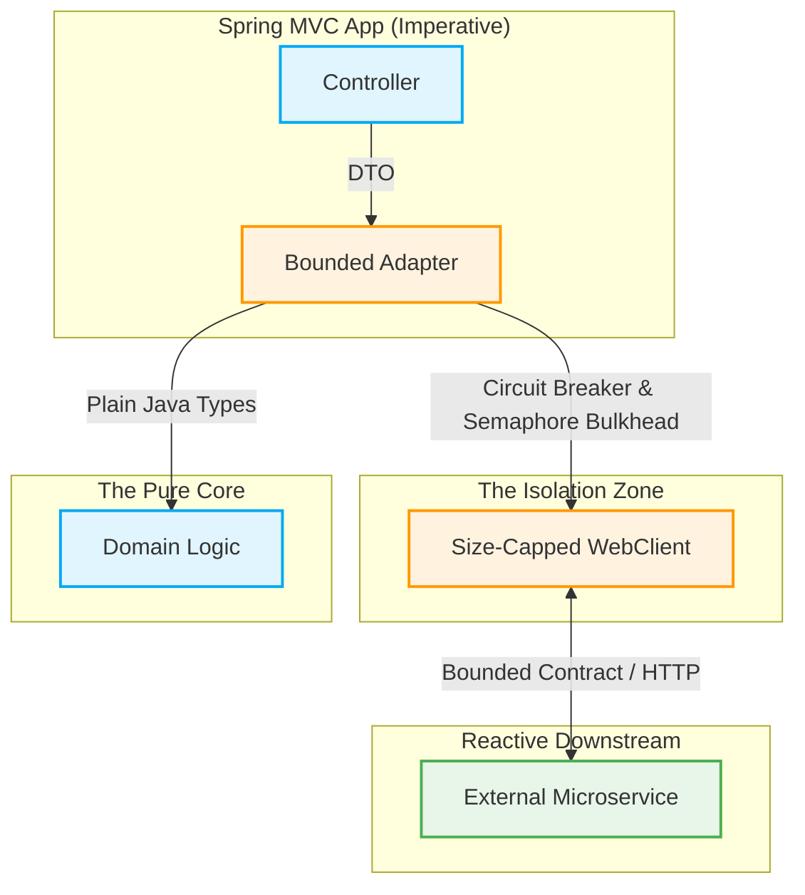

## 🧱 Engineering Brick: The Backpressure Betrayal & The Blueprint for Safe Boundaries

🌸 *A river flows as fast as it can,*  
*When an unmeasured bridge takes an unbounded span.*

### 🪞 1. The Final Autopsy: Materialization Under Load

Over the past three autopsies, we have dissected subtle structural failures that arise when imperative and reactive execution models meet without explicit contracts. We examined the [Concurrency Illusion]() where request threads saturated while CPU stayed low, the [Temporal Rift]() around retry time semantics, and the [Context Propagation Collapse]() across scheduler hops.

Our fourth autopsy examines a failure mode that targets **heap headroom**: what happens when an imperative Spring MVC endpoint uses a streaming `WebClient` and then asks Reactor to materialize the entire response into a single `List` on the heap.

Consider a representative failure scenario. A Spring MVC endpoint calls an internal HTTP service via `WebClient` to assemble a transaction report. With small test payloads, everything passes cleanly. Under large responses or peak concurrent traffic, JVM heap climbs rapidly toward `OutOfMemoryError` (OOM)—not from a slow traditional memory leak, and often without high CPU saturation beforehand.

```java
@GetMapping("/api/v1/reports/transactions")
public ResponseEntity<List<TransactionDTO>> getReport() {
    // ❌ Illustrative anti-pattern: unbounded materialization + unbounded blocking wait
    List<TransactionDTO> transactions = webClient.get()
        .uri("/internal/transactions?status=COMPLETED")
        .retrieve()
        .bodyToFlux(TransactionDTO.class)
        .collectList() // Retains every decoded DTO in an ArrayList until onComplete
        .block();      // Blocks the MVC request thread waiting for the Mono<List<...>>

    return ResponseEntity.ok(transactions);
}
```

### ☯️ 2. Two Separate Mechanisms: Whole-Response Buffering vs. Blocking Wait

A common misconception is treating `.collectList().block()` as a single mysterious operator or assuming it sends a literal `"request(Long.MAX_VALUE)"` protocol command across plain HTTP. Separating the two steps makes the failure mechanics crystal clear:

1. **What `.collectList()` does inside Project Reactor (`FluxCollectList`):**
   `collectList()` issues unbounded demand (`request(Long.MAX_VALUE)`) to its **upstream `Flux` operator chain** and buffers every emitted `TransactionDTO` inside an internal `ArrayList` until the upstream completes (`onComplete`). Over plain HTTP/1.1 or HTTP/2 (unlike RSocket), TCP flow control still regulates socket bytes between hosts, and `WebClient` codecs still apply per-element decoding buffers (`maxInMemorySize`, default 256 KB)—but **none of those layers prevent `collectList()` from accumulating every decoded DTO in the heap** because its return contract promises a complete `List`. Even if you rewrote upstream demand to request items in smaller batches, `collectList()` would still retain the entire dataset by the time the response finishes.
2. **What `.block()` does at the boundary:**
   `.block()` simply parks the calling MVC thread until that `Mono<List<TransactionDTO>>` completes (or errors). It contributes thread occupancy and wait latency, while `collectList()` drives whole-response heap retention.

A streaming client (`WebClient`) can therefore **still retain the entire response** the moment the caller contract collapses a `Flux<T>` into a materialized `List<T>`.

### 📊 3. Quantitative Mandate: Separate Size and Concurrency Budgets

When an incremental streaming pipeline processes items one by one and releases each processed reference immediately, retained memory tracks the active in-flight window and configured `prefetch` buffer. For simple constant-rate queue models, queue backlog (in items) grows with `(Rate_Production - Rate_Consumption) × Time` unless upstream slows down.

Once an imperative endpoint materializes the full payload via `.collectList().block()`, per-item streaming bounds no longer cap total retention. Peak retained heap scales with **two independent budgets**—not time alone:

$$\text{Peak Retained Heap} \approx N_{\text{items}} \times \overline{\text{Size}}_{\text{DTO}} \times C_{\text{concurrent}}$$

(plus intermediate Jackson decoding allocations and response serialization buffers held until the controller writes the HTTP body).

Notice the architectural consequence:
- Adding only a timeout (`.block(Duration)`) limits **how long** the thread waits, not how many megabytes arrive before that deadline.
- Limiting only item count (`1,000` items) still leaves heap exposed if DTO byte sizes vary widely or if 200 concurrent callers run simultaneously (`1,000 items × 40 KB × 200 concurrent ≈ 8 GB`).

Before tuning buffers, however, ask the primary architectural question.

### 💠 4. The Architectural Core Question: Does This Endpoint Need `List<T>`?

*"Does this endpoint genuinely require materializing a full `List` in an MVC handler?"*

- **Option A — True End-to-End Non-Blocking Streaming (`WebFlux`):** If the client only consumes a stream of records and no blocking JPA/JDBC dependencies stand in the way, **Spring WebFlux** preserves end-to-end non-blocking I/O and reactive backpressure across network boundaries (running on Netty by default, or on Servlet 3.1+ non-blocking containers such as Tomcat or Jetty).
- **Option B — Streaming in Spring MVC:** Even within Spring MVC, returning `Flux<T>` with streaming media types (`application/x-ndjson` or `text/event-stream`) lets the downstream pull reactively without buffering the entire response into a `List`—though writing response bytes remains blocking on an MVC async executor.
- **Option C — Asynchronous Export Job:** When generating large reports (tens of thousands of rows, heavy joins, or multi-megabyte exports), synchronous HTTP request-response is the wrong transport regardless of framework. Enqueue an asynchronous job (e.g., Kafka/RabbitMQ + object storage), process incrementally in the background, and let the client poll or receive a webhook.
- **Option D — Bounded Synchronous Adapter (`MVC` + `List`):** When an existing MVC endpoint genuinely needs a small materialized `List` for legacy callers, synchronous PDF generation, or transactional orchestration, use an **explicitly bounded adapter** with separate budgets for data size and concurrency.

### 🧭 5. The Decision Framework: Matching Transport to Workload

| Scenario | Architectural Choice | Mechanism & Budget Ownership |
| :--- | :--- | :--- |
| **Continuous streaming I/O, no blocking downstream** | **Spring WebFlux (Non-Blocking Pipeline)** | End-to-end `Flux` with reactive backpressure across Netty or non-blocking Servlet containers. |
| **Simple CRUD with bounded rows & blocking JPA** | **Standard Spring MVC** | Synchronous controller + pooled JDBC/RestClient; explicit query pagination. |
| **MVC endpoint facing thread-pool wait exhaustion** | **MVC + Java 21 Virtual Threads** | Cuts platform-thread blocking overhead on bounded calls, but **does not** reduce `.collectList()` heap retention. |
| **MVC handler needs a small reactive `List` (`WebClient`)** | **Bounded Synchronous Adapter** | Enforce client+contract item/byte caps, `.block(Duration)` deadline, `@Bulkhead(SEMAPHORE)`, and `@CircuitBreaker`. |
| **Large dataset aggregation or report export** | **Async Job / Queue + Webhook or Polling** | Decouple request from generation; stream/chunk output to durable storage outside the HTTP cycle. |

### 🗺️ 6. The Blueprint for Bounded Synchronous Adapters

For workloads in the *Bounded Synchronous Adapter* row, every boundary crosses three distinct guards: **Domain Purity**, **Payload Budget**, and **Concurrency & Failure Isolation**.



#### ⛩️ Rule 1: Keep Reactive Contracts Out of the Domain Core

Ideally, pure business domain logic stays agnostic to reactive frameworks. Returning `Mono` or `Flux` from domain services introduces Project Reactor semantics into the **domain contract**—coupling domain composition, exception handling, and caller APIs to lazy reactive subscriptions and scheduler conventions (even though simple synchronous `Mono` pipelines can still be unit-tested on a JUnit thread without spinning up a Netty event loop). Keep transformation from `List<TransactionDTO>` to domain objects at the adapter boundary:

```java
// Pure Java domain model and rules: no Mono, no Flux in the domain contract.
public class TransactionAnalyzer {
    public RiskScore analyze(List<Transaction> transactions) {
        // deterministic business rules
        return new RiskScore(/* ... */);
    }
}
```

#### ⛩️ Rule 2: Enforce Payload Budgets on Both Contract and Client

Passing `?limit=1000` to an upstream service is only a **downstream query parameter**—it protects nothing if the downstream service ignores `limit`, has a regression, or returns oversized JSON objects. Nor does `1,000` items guarantee a fixed heap budget without an assumption on DTO byte weight.

A defensive adapter enforces bounds on **both sides**:
1. Configure `WebClient` codec `maxInMemorySize` (default 256 KB) strictly to bound **codec chunk buffering during decoding** rather than disabling it (`-1`)—recognizing that codec byte caps do not bound the `List<TransactionDTO>` accumulated afterward by `collectList()`.
2. Send `?limit=maxItems` to avoid wasted upstream work, **and** apply `.take(maxItems + 1)` client-side before `collectList()`, failing fast with an explicit error if the count exceeds `maxItems` rather than buffering without limit or silently truncating.

```java
// Bounded payload adapter: assumes downstream honors ?limit, yet enforces hard client caps.
public List<TransactionDTO> fetchTransactionsBounded(String status, int requestedLimit) {
    final int maxItems = 500;
    int boundedLimit = Math.min(Math.max(requestedLimit, 1), maxItems);

    List<TransactionDTO> items = webClient.get()
        .uri(builder -> builder.path("/internal/transactions")
            .queryParam("status", status)
            .queryParam("limit", boundedLimit) // Downstream contract hint
            .build())
        .retrieve()
        .bodyToFlux(TransactionDTO.class)
        .take(boundedLimit + 1L)              // Hard client-side cap + overflow sentinel
        .collectList()
        .block(Duration.ofSeconds(5));        // Wait deadline for this call only

    if (items == null) {
        return List.of();
    }
    if (items.size() > boundedLimit) {
        throw new PayloadBudgetExceededException(
            "Downstream ignored limit contract; aborted past " + boundedLimit + " items");
    }
    return items;
}
```

#### ⛩️ Rule 3: Separate Concurrency & Failure Budgets (and Know Exactly When Locks Release)

In Spring Boot + Resilience4j, annotations are enforced through Spring AOP proxies, so the guarded method must live on a separate Spring bean injected into the controller rather than being invoked internally on `this` (self-invocation bypasses AOP interceptors completely). In Resilience4j's default aspect order, `@CircuitBreaker` wraps outside `@Bulkhead` (`CircuitBreaker -> Bulkhead -> Target Method`):

```java
// Bounded synchronous adapter example (split into separate Spring beans so AOP proxies apply).
@Service
public class DownstreamTransactionAdapter {

    private final WebClient webClient;

    public DownstreamTransactionAdapter(WebClient webClient) {
        this.webClient = webClient;
    }

    @CircuitBreaker(name = "downstream-transactions")
    @Bulkhead(name = "downstream-transactions", type = Bulkhead.Type.SEMAPHORE)
    public List<TransactionDTO> loadBoundedTransactions(String status, int limit) {
        return fetchTransactionsBounded(status, limit);
    }
    // ... fetchTransactionsBounded(status, limit) as bounded above
}

@RestController
public class TransactionReportController {

    private final DownstreamTransactionAdapter transactionAdapter;

    public TransactionReportController(DownstreamTransactionAdapter transactionAdapter) {
        this.transactionAdapter = transactionAdapter;
    }

    @GetMapping("/api/v1/reports/transactions")
    public ResponseEntity<List<TransactionDTO>> getReport(
            @RequestParam(defaultValue = "200") int limit) {
        List<TransactionDTO> data = transactionAdapter.loadBoundedTransactions("COMPLETED", limit);
        return ResponseEntity.ok(data);
    }
}
```

```yaml
resilience4j:
  circuitbreaker:
    instances:
      downstream-transactions:
        slidingWindowSize: 20
        failureRateThreshold: 50
        ignoreExceptions:
          # Local admission rejection must not trip the downstream health breaker
          - io.github.resilience4j.bulkhead.BulkheadFullException
  bulkhead:
    instances:
      downstream-transactions:
        maxConcurrentCalls: 30
        maxWaitDuration: 0ms
```

Every safeguard in this bounded synchronous adapter has a **strictly scoped boundary**:
- **What `@CircuitBreaker` measures:** Because `@CircuitBreaker` wraps `@Bulkhead` by default, a saturated bulkhead throws `BulkheadFullException`, which would be recorded as a failure unless excluded via `ignoreExceptions`. With `BulkheadFullException` ignored, the circuit breaker trips at its configured `failureRateThreshold` strictly on actual downstream errors, timeouts, or payload-contract violations.
- **Where `@Bulkhead(SEMAPHORE)` and the heap budget end:** `maxConcurrentCalls` limits concurrent threads actively executing inside the `@Service` adapter, and `maxInMemorySize` caps only codec chunk buffering during HTTP decode. Because the semaphore permit releases as soon as `loadBoundedTransactions` returns `List<TransactionDTO>`, Spring MVC and Jackson can still keep serialized or in-flight `List` payloads on the heap while writing to slow HTTP clients. Use `maxConcurrentCalls × (maxItems × avgDtoBytes)` to size active adapter assembly, and explicitly add in-flight response writes when sizing total endpoint heap headroom alongside downstream connection pools.
- **What `.block(Duration)` bounds:** It caps how long the calling thread waits on that specific downstream call—protecting caller latency budgets rather than bytes buffered prior to timeout.

## 🗝️ Brick Summary: Mental Model

* **🌠 Signal:** Integrating a streaming `WebClient` response into a synchronous MVC handler that expects a materialized `List`.
* **🧩 Structure:** Downstream + client-side payload budget (`take` + codec byte cap + overflow check) + wait deadline (`.block(Duration)`) + `@CircuitBreaker` + `@Bulkhead(SEMAPHORE)` sized to DTO weight, heap headroom, and connection pools.
* **🏛️ Invariant:** **Data size and caller concurrency require separate budgets.** Never materialize an unbounded `Flux` with `.collectList().block()` without capping both bytes/items per call and concurrent executions.
* **💠 Pivot Insight:** In this hybrid pattern, an unexpected OOM often reflects materialized buffering (`collectList()`) colliding with unbudgeted payload sizes and concurrent callers rather than a classic leak.

---

🪷 *One thought to keep sharp*: **"A streaming client can still retain the entire response. In Reactor, `collectList()` holds every decoded item until completion—so if an MVC endpoint needs a list, give that list a size budget and give concurrent requests a separate budget."**

### 🌀 Epilogue: The End of the Autopsy

With context propagation and bounded synchronous adapters clearly defined, our **Autopsy of a Hybrid Architecture** is complete. Across four parts, we traced how mixing imperative and reactive assumptions breaks in subtle ways: from thread starvation and retry time shifts, to context drops across scheduler hops, and finally whole-response materialization under load.

Fixing concurrency inside a single JVM node is only half the picture. When requests fan out to durable queues or slow external consumers like LLM APIs, memory and backpressure problems reappear at the broker and worker boundary.

> **Next up**: In **System Design — The Global Nervous System**, we step beyond a single node to dissect Kafka backpressure, slow-consumer isolation, and durable correctness across distributed boundaries.

---
*End of Series.*
